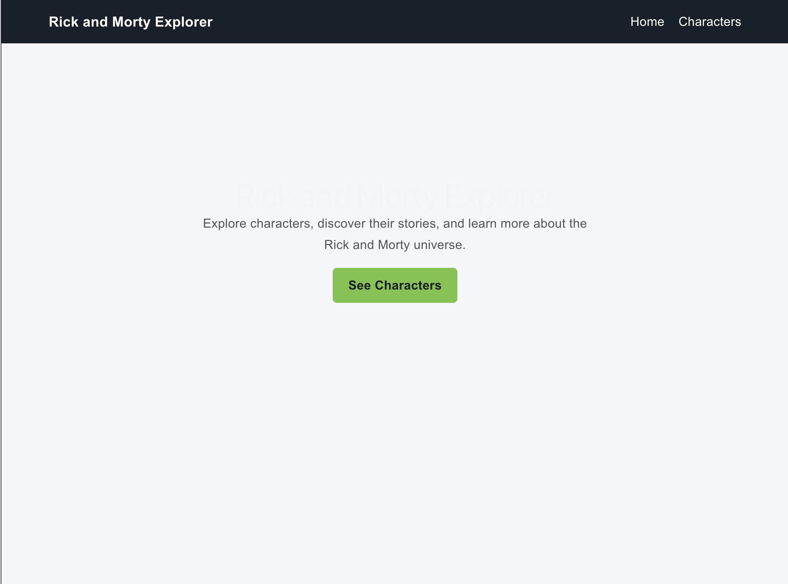
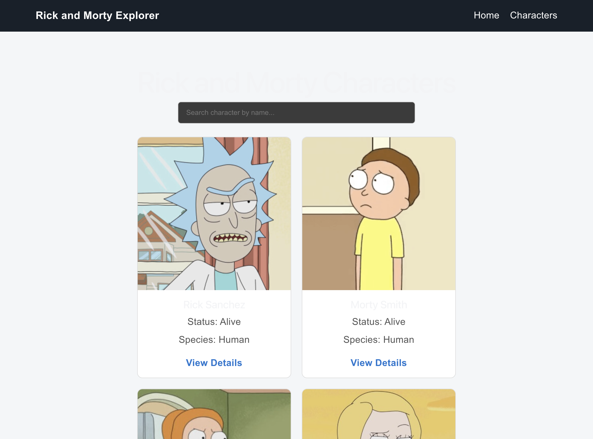

# PS4 - Rick and Morty Explorer

A React web application to explore characters from the Rick and Morty universe.

## Project Details

- **Problem Statement:** PS4
- **Project Name:** Rick and Morty Explorer
- **Frontend:** React and Vite
- **Routing:** React Router DOM
- **Styling:** CSS

## API Used

[ Rick and Morty API ](https://rickandmortyapi.com/api/character)

## Features

- Browse characters with images and information

# PS4 - Rick and Morty Explorer

A React web application to explore characters from the Rick and Morty universe.

## Project Details

- **Problem Statement:** PS4
- **Project Name:** Rick and Morty Explorer
- **Frontend:** React and Vite
- **Routing:** React Router DOM
- **Styling:** CSS

## API Used

Rick and Morty API: https://rickandmortyapi.com/api/character

## Features

- Browse characters with images and details
- Search characters by name
- Navigate between pages
- View individual character details
- Loading and error messages
- Responsive character card layout
- Not Found page
- Responsive character cards
- Not Found page for invalid routes

## Routes

| Route | Description |
|---|---|
| `/` | Home page |
| `/characters` | Character list, search and pagination |
| `/characters/:id` | Character details |
| `*` | Not Found page |

## Screenshots

### Home Page

### Characters Page

## Live Demo

Deployment link will be added here.
## Run Locally

1. Clone this repository.
2. Run `npm install`.
3. Run `npm run dev`.
4. Open the local URL shown in the terminal.
